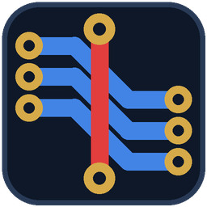
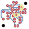

<p align="center"></p>

# Roteador CNC para KiCad

Plugin do KiCad que **posiciona as peças e roteia a placa** pensando em quem vai **fresar em casa
e soldar na bancada** — não em fábrica de PCB.

- **Nenhuma solda do lado dos componentes.** Trilha pode andar pelas duas faces, mas nunca chega
  num pad por cima: um pouco antes, ela desce por uma via e chega por baixo.
- **Trilhas a 45°**, com poucas curvas. Cada degrau a mais é um lugar onde a fresa deixa rebarba.
- **Via soldável.** A via é um furo comum, com a mesma broca e a mesma ilha dos pads (0,8 mm /
  2,5 mm). Você passa um fio e solda dos dois lados.
- **Respeita o projeto.** Folga da classe de rede, folga cobre–borda do Board Setup e **áreas
  proibidas quaisquer** (trilha, via, footprint), em qualquer formato — inclusive as que vêm
  dentro de um footprint, como a proteção de um furo de fixação.
- **Plano de GND.** Se a placa tem uma zona de cobre com rede na face de baixo (o plano de GND),
  o roteador deixa o plano ligar os pads dessa rede e só faz trilha para costurar os pedaços
  que as outras trilhas separaram. Cada pad precisa de pelo menos dois raios de alívio térmico
  chegando ao plano para contar como ligado. E o plano é **prioridade**: atravessar o plano na
  face de baixo custa mais para as outras redes, e entre posições que fecham, ganha a que
  deixa mais plano inteiro ligado ao GND. Plano na face de cima ligado a pad seria solda do
  lado dos componentes: a janela avisa.
- **Plano de GND nas duas faces.** O plano de baixo liga nos pads; o de cima, com a conexão com
  pads desligada, liga por vias de costura e trilha. O de cima não abre caminho para as outras
  redes — ajuda blindagem e GND, não o roteamento.
- **Peças dos dois lados (opcional).** O posicionador pode virar peças para baixo. Cada peça
  continua soldando de um lado só — o oposto ao corpo dela —, então a peça virada é ligada pela
  face de cima. Corpos em lados opostos podem dividir a mesma área, desde que nenhum cubra os
  pads (as soldas) do outro.
- **Conector na periferia.** Conectores (J, P, CN, X ou footprint de conector) ficam na parte de
  fora do circuito, sem peça entre eles e a borda — sem serem empurrados contra a borda.
- **Respeita o seu cadeado.** Peça travada no KiCad não se move. Furo de fixação também não.
- **Não mexe sem você ver.** Primeiro mostra o resultado; só aplica se você confirmar. E um
  **Ctrl+Z** desfaz tudo.

O núcleo (rasterização, A*, posicionador) é em **C**. O Python é só a ponte com o KiCad: lê a
placa, desenha a janela e escreve as trilhas.



---

## Instalar

### Pelo gerenciador de plugins do KiCad (recomendado)

1. No KiCad: **Ferramentas → Gerenciador de Plugins e Conteúdo** (*Plugin and Content Manager*).
2. **Gerenciar...** (*Manage*) → **Adicionar** e cole:

   ```
   https://raw.githubusercontent.com/aluisioalves123/kicad-cnc-router/main/pcm/repository.json
   ```

3. Escolha esse repositório na lista do topo, selecione **Roteador CNC** → **Instalar** →
   **Aplicar alterações**.

Assim as atualizações chegam pelo próprio KiCad.

### Pelo arquivo .zip

Baixe o `.zip` da [última release](https://github.com/aluisioalves123/kicad-cnc-router/releases)
e, no gerenciador de plugins, use **Instalar a partir de arquivo...**.

### Requisitos

| | |
|---|---|
| KiCad | 10.0 ou mais novo |
| Windows | 64 bits — núcleo já compilado no pacote |
| Linux | 64 bits, glibc 2.35+ (Ubuntu 22.04, Debian 12 ou mais novo) — já compilado |
| macOS | sem binário pronto: compile o núcleo (veja abaixo) |

---

## Usar

No editor de placa, clique no ícone **Roteador CNC** na barra de ferramentas (ou
**Ferramentas → Plugins externos → Roteador CNC**).

1. A janela mostra o que o plugin leu: regras, contorno, áreas proibidas, peças travadas.
2. Escolha se ele pode **mover as peças**, se os **conectores vão para a periferia**, se pode pôr
   **peças dos dois lados** e o **tempo máximo** (120 s por padrão).
3. **Posicionar e rotear.** Ele sorteia posições em paralelo e mostra o progresso ao vivo; para
   sozinho quando fecha a placa inteira. **Parar** encerra e fica com a melhor até ali.
4. Confira o resultado: ligações abertas, peças que mudam, trilhas e vias novas, e uma
   conferência de folgas medida em milímetros, independente do roteador.
5. **Aplicar na placa.** Pede confirmação, troca as trilhas e move as peças. Ctrl+Z desfaz.

Depois, rode o **DRC do KiCad** como sempre — o plugin foi validado contra ele, mas a palavra
final é dele.

### Regras de fabricação

| | | por quê |
|---|---|---|
| trilha | 0,8 mm | sai limpa na fresa com ponta V 30° a 0,2 mm de profundidade |
| folga entre redes | 0,4 mm, ou a do projeto se for maior | o DRC do seu projeto manda |
| cobre até a borda | a do Board Setup | idem |
| broca (pads e vias) | 0,8 mm | uma ferramenta só para tudo |
| ilha da via | 2,5 mm | do tamanho de um pad: dá para soldar |
| grade do roteador | 0,1 mm | erro geométrico de 0,05 mm, abaixo do que a fresa resolve |

Os valores ficam em [`cnc_router/regras.py`](cnc_router/regras.py), cada um com a razão de ser.

---

## Como funciona

**Rasterização.** A placa vira uma grade de 0,1 mm por face. Cada obstáculo entra já **inflado**
de meia trilha mais a folga, então a busca só pergunta "esta célula está livre para a minha
rede?". Pad na face de cima é obstáculo **até para a própria rede** — é isso que obriga a
chegada por baixo.

**A\* em 8 direções.** Na grade fina, a diagonal *é* o segmento a 45°. O estado guarda a direção
de chegada, para cobrar cada curva (45° custa menos que 90°). A via só é tentada onde a ilha
inteira de 2,5 mm cabe nas duas faces — conferido por imagem integral, em quatro somas.

**Rip-up & reroute.** Se sobra ligação aberta, a placa volta ao que era e roteia de novo, com
as redes que falharam na frente da fila. Fica a melhor passada.

**Posicionador com o roteador como juiz.** Recozimento simulado gera candidatos (posição e giro
de 90° em 90°); cada candidato legal é **roteado de verdade** e ganha quem fecha mais
ligações, depois quem deixa os conectores na periferia, depois quem corta menos o plano de GND,
depois quem usa menos vias. Rede que não
fecha passa a pesar mais nos sorteios seguintes. Roda em metade dos núcleos da máquina, para não travar o computador.

**Legal é o que o KiCad aceita.** O corpo de cada peça é o casco do **courtyard real** (não a
caixa dele), sem encostar em outro; nenhuma peça fica fora da placa ou em área que proíbe
footprint; nenhum pad fica a menos da folga de borda.

### Limitações conhecidas

- O contorno da placa é tratado pela **caixa** dele no posicionador. Em placa retangular dá no
  mesmo; numa placa em L, uma peça poderia ser posta no recorte. O roteador usa o contorno real.
- Peças giram de 90° em 90°.
- A interface está em português.

---

## Para desenvolver

O plugin carrega da pasta `plugins` do KiCad. Para trabalhar no código, clone com um nome que
seja módulo Python válido (sem hífen) e compile o núcleo:

```bash
git clone https://github.com/aluisioalves123/kicad-cnc-router.git kicad_cnc_router
```

```bash
sh kicad_cnc_router/nucleo/build.sh
```

`build.sh` usa `gcc` (no Windows, MinGW-w64) e gera `perfcnc.dll` ou `perfcnc.so`. O Python
confere a versão da interface (ABI) antes de chamar qualquer coisa e recusa binário de outra
versão.

Roteia pela linha de comando, gravando ao lado do original (`*-roteado.kicad_pcb`) e rodando o
DRC do KiCad no resultado:

```bash
"C:\Program Files\KiCad\10.0\bin\python.exe" rotear.py placa.kicad_pcb
```

Testes (comparam a geometria do plugin com o KiCad girando as peças de verdade, inclusive a 45°):

```bash
"C:\Program Files\KiCad\10.0\bin\python.exe" -m unittest tests.test_giro
```

Com a variável `PLACA_DE_TESTE` apontando para um `.kicad_pcb` com pads ovais e courtyard.

Pacote do gerenciador de plugins: `python ferramentas/empacota.py` (precisa do `.dll` e do `.so`).

---

Feito por [Aluisio Cunha](https://hardware.aluisiocunha.com.br). Do mesmo autor:
[Perfboard Router](https://github.com/aluisioalves123/perfboard-router).

Licença MIT.
